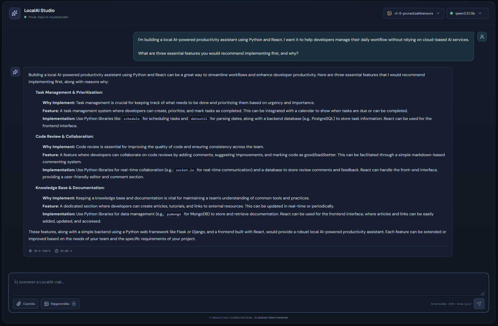
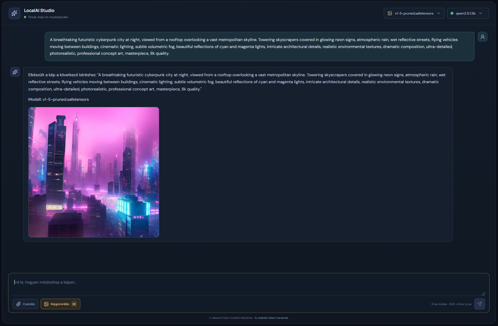
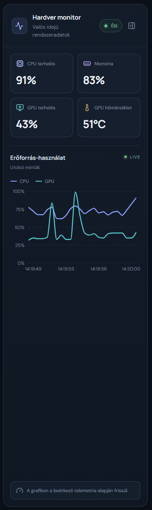
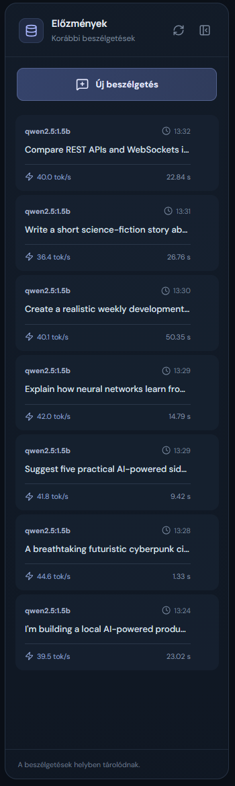

# LocalAIRunner

**A local AI workspace for running language models, generating images, and monitoring hardware performance.**

LocalAIRunner is a personal project designed to bring locally hosted AI tools into a single interface. It combines an LLM chat interface powered by Ollama, image generation through ComfyUI, conversation history management, and real-time hardware monitoring.

The main goal of the project is to make experimenting with local AI models easier while providing useful information about system resource usage and model performance.

## Features

### Local LLM Chat
- Chat with locally hosted language models through Ollama.
- Stream responses in real time using Server-Sent Events (SSE).
- Configure model parameters such as temperature.
- Measure model performance, including:
  - Time to First Token (TTFT)
  - Tokens per second (TPS)
  - Total response latency

### Image Generation
- Generate images using ComfyUI.
- Retrieve available checkpoint models dynamically.
- Support for text-to-image generation.
- Support for image-to-image generation using uploaded images.
- Display generated images directly in the application.

### Conversation History
- Automatically save conversations to a PostgreSQL database.
- Store model information and generation metrics.
- Rename and delete previous conversations.
- Keep track of conversation timestamps and settings.

### Hardware Monitoring
- Real-time CPU and RAM usage monitoring.
- NVIDIA GPU utilization and VRAM monitoring.
- GPU temperature monitoring.
- WebSocket-based telemetry updates.

## Screenshots

### Chat Interface

The main chat interface for interacting with locally hosted language models through Ollama.



### Image Generation

Generate images locally using ComfyUI.



### Hardware Monitoring

Monitor real-time CPU, RAM, GPU utilization, and GPU temperature.



### Conversation History

Rename and delete previously saved conversations.



## Technology Stack

| Component | Technology |
|---|---|
| Backend | Python, FastAPI |
| Frontend | React |
| LLM Runtime | Ollama |
| Image Generation | ComfyUI |
| Database | PostgreSQL |
| ORM | SQLAlchemy |
| Data Validation | Pydantic |
| Async HTTP Client | HTTPX |
| Hardware Monitoring | psutil, NVIDIA NVML |
| Real-time Communication | WebSockets, SSE |

## Architecture Overview

LocalAIRunner uses a frontend-backend architecture.

- **React frontend:** Provides the user interface for chatting, image generation, conversation management, and hardware monitoring.
- **FastAPI backend:** Handles API requests, communicates with local AI services, manages database operations, and collects hardware metrics.
- **Ollama:** Runs local language models and streams generated responses.
- **ComfyUI:** Handles image generation workflows.
- **PostgreSQL:** Stores conversation history, model information, and performance metrics.

```text
                  React Frontend
                        |
                        v
                  FastAPI Backend
                   /     |      \
                  /      |       \
                 v       v        v
              Ollama  PostgreSQL  ComfyUI
                 |
                 v
          Local Language Models

          Hardware Monitoring
                 |
                 v
             psutil / NVML
                 |
                 v
           WebSocket Stream
                 |
                 v
             React UI
```

## Requirements

Before running the project, make sure the following tools are installed:

- Python 3.10+
- Node.js and npm
- PostgreSQL 16+
- Ollama
- ComfyUI
- NVIDIA GPU with compatible drivers (optional, for NVIDIA GPU monitoring)

The application can operate without NVIDIA GPU monitoring, although GPU-specific metrics will not be available.

## Installation

### 1. Clone the repository

```bash
git clone https://github.com/LeventeForro/LocalAIRunner.git
cd LocalAIRunner
```

### 2. Set up the backend

Navigate to the backend directory:

```bash
cd backend
```

Create and activate a virtual environment:

```bash
python -m venv venv
```

Windows:

```powershell
.\venv\Scripts\activate
```

Install the required Python packages:

```bash
pip install -r requirements.txt
```

### 3. Configure the database

Make sure PostgreSQL is running and create a database for the project.

Create a `.env` file in the backend directory:

```env
PROJECT_NAME=LocalAIRunner API
API_V1_STR=/api/v1

POSTGRES_USER=ai_runner_user
POSTGRES_PASSWORD=your_password
POSTGRES_HOST=localhost
POSTGRES_PORT=5432
POSTGRES_DB=local_ai_runner_db
```

Update the values according to your local PostgreSQL configuration.

### 4. Start Ollama

Install Ollama and download at least one language model.

For example:

```bash
ollama pull llama3.2:latest
```

Make sure the Ollama service is running and accessible at:

```text
http://localhost:11434
```

### 5. Configure ComfyUI

Install and configure ComfyUI separately.

Make sure the ComfyUI server is running at:

```text
http://127.0.0.1:8188
```

The backend also requires the correct ComfyUI input directory to be configured in the image generation module.

### 6. Start the backend

From the backend directory, run:

```bash
uvicorn app.main:app --reload
```

The API will be available at:

```text
http://localhost:8000
```

Interactive API documentation:

```text
http://localhost:8000/docs
```

### 7. Start the frontend

Open a separate terminal, navigate to the frontend directory, install dependencies, and start the development server:

```bash
npm install
npm run dev
```

The frontend address depends on the development server configuration, usually:

```text
http://localhost:5173
```

## API Endpoints

The backend currently provides the following endpoints:

| Method | Endpoint | Description |
|---|---|---|
| POST | `/chat/stream` | Streams responses from a local LLM |
| GET | `/history` | Retrieves saved conversations |
| PUT | `/history/{run_id}` | Renames a conversation |
| DELETE | `/history/{run_id}` | Deletes a conversation |
| GET | `/image-models` | Retrieves available ComfyUI checkpoint models |
| POST | `/generate-image` | Generates an image using ComfyUI |
| WS | `/ws/telemetry` | Streams hardware metrics |
| GET | `/health` | Returns backend health information |

## Performance Metrics

One of the main goals of LocalAIRunner is to make local model performance easier to observe.

The application collects several metrics during text generation:

- **TTFT (Time to First Token):** Measures how long it takes for the model to produce its first response token.
- **TPS (Tokens Per Second):** Estimates the generation speed based on received Ollama stream chunks.
- **Latency:** Measures the total time spent generating a response.
- **Hardware Usage:** Displays CPU, RAM, GPU, and VRAM utilization.

These metrics can help compare different local models and understand how they perform on a specific machine.

## Project Status

LocalAIRunner is an ongoing personal development project.

The current implementation focuses on local AI integration, streaming responses, image generation, conversation persistence, and hardware monitoring.

Some parts of the application may still change as new features are added and existing functionality is improved.

## Future Improvements

Potential improvements include:

- More detailed model performance comparisons.
- Historical hardware telemetry charts.
- Improved error handling and service availability checks.
- More flexible model configuration.
- Better support for different hardware configurations.
- Docker-based deployment and easier environment setup.
- Automated tests for backend services and API endpoints.

## Disclaimer

This project is intended for personal use, experimentation, and learning.

It is not designed as a production-ready AI platform. Performance depends on the hardware, models, and local services available on the host machine.